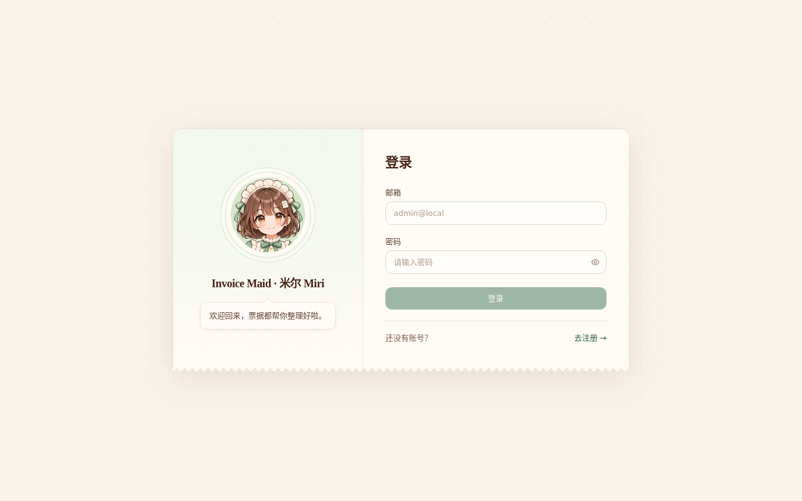
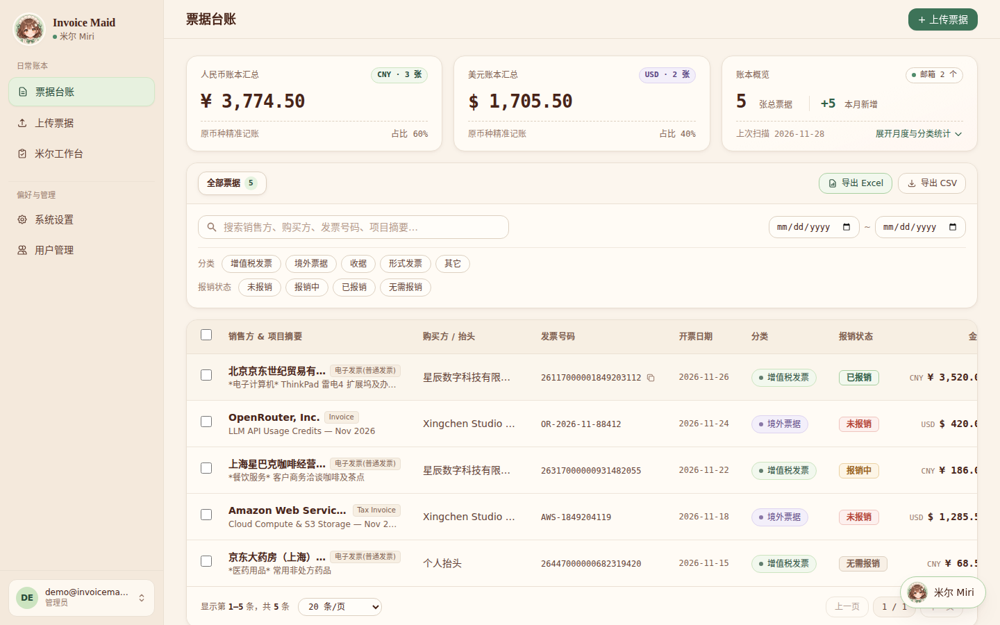
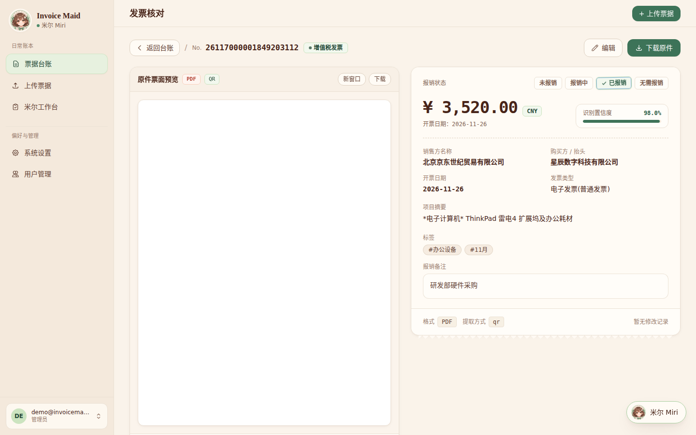
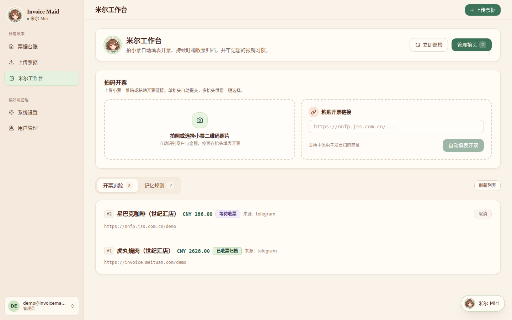
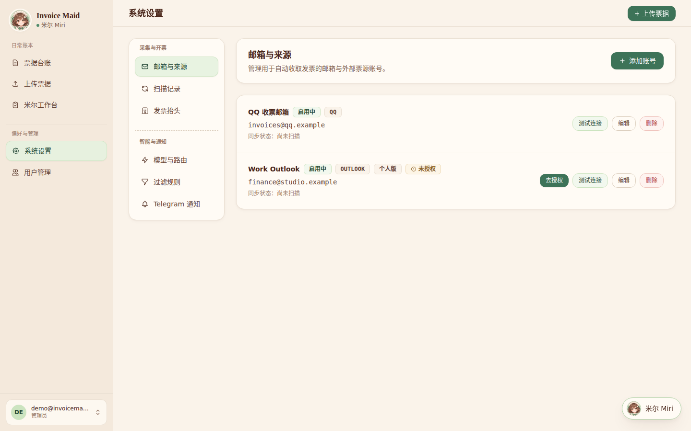
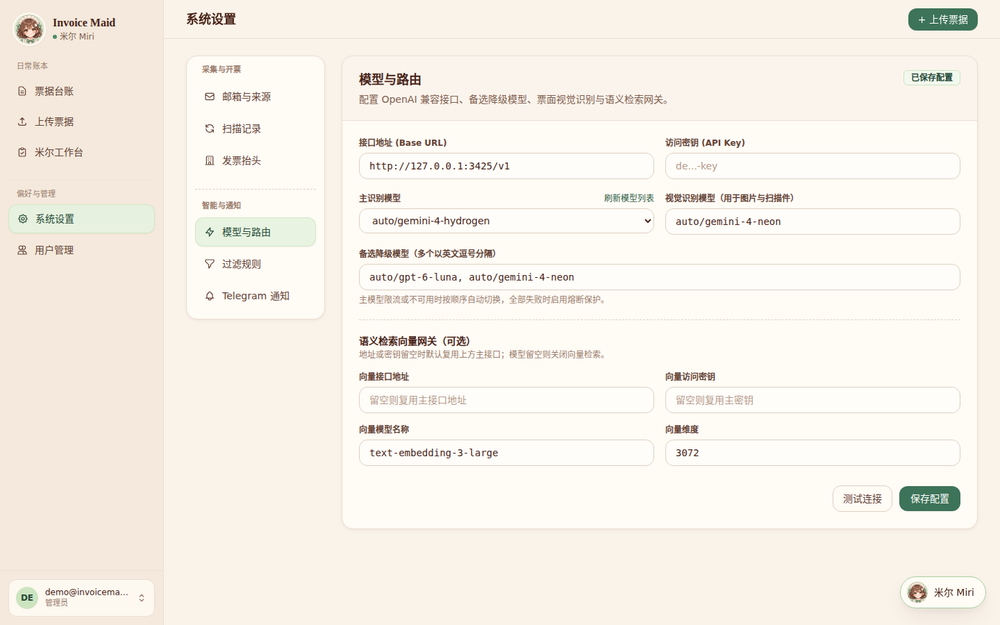

# Invoice Maid · 米尔 Miri

<p align="center">
  
</p>

<p align="center">
  <strong>Self-hosted AI invoice ledger &amp; multimodal agent assistant.</strong><br>
  Automatically collect invoices from email inboxes, claim offline QR receipts via a Vision Browser Agent, track multi-currency reimbursements, and chat with <strong>Miri (米尔)</strong> in a warm stationery Web UI or on Telegram.
</p>

<p align="center">
  
  
  
  
  
  
  
</p>

---

## Why Invoice Maid?

Invoice Maid automates the entire personal &amp; small-team invoice lifecycle on your own server:

- **Automated inbox ingestion** — Scans **IMAP**, **POP3**, **QQ Mail**, and **Microsoft Outlook (Graph Delta Query)** across every scannable folder with persistent retry queues (`failed_emails`) and watermark protection.
- **Multi-format parsing &amp; VLM fallback** — Parses **PDF**, **XML**, and **OFD (数电票)** invoices (including Chinese railway &amp; airline e-tickets and body download links), automatically rendering image-only scanned PDFs for a Vision LLM fallback when text extraction fails.
- **Resilient multi-model AI routing** — Supports any OpenAI-compatible API (including local gateways like Magpie) with ordered fallback model chains, circuit breaking, SHA-256 response caching, and an independent embedding endpoint.
- **True multi-currency &amp; reimbursement loop** — Preserves real ISO-4217 currencies (`CNY`, `USD`, `EUR`, `GBP`, `HKD`, `JPY`, …), tracks reimbursement status (`未报销` / `报销中` / `已报销` / `无需报销`), tags, notes, zero-dependency Excel (`.xlsx`) exports, and one-click **Reimbursement Pack ZIPs**.
- **Miri (米尔) Agent Loop — Web UI &amp; Telegram** — An IM-agnostic tool-calling assistant with 14 tools, persistent long-term memory rules, multi-profile invoice headers, and a **Set-of-Mark Multimodal Vision Browser Agent** that turns offline receipt photos into submitted invoices automatically.
- **Warm Stationery Ledger Web UI** — Bespoke cream-and-sage-mint design system ([VI Design System](docs/VI-DESIGN-SYSTEM.md)) featuring a desktop stationery sidebar, mobile bottom tab bar, 50/50 PDF verification workbench, floating batch dock, and companion Miri chat drawer.

### How it works

<p align="center">
  
</p>

Email scans, manual drag-and-drop uploads, and Miri's offline QR claiming all flow into the **same** unified ingestion pipeline (`invoice_ingestion.py`): deterministic parsing (PDF / XML / OFD + QR) → LLM/VLM enrichment &amp; currency detection → deduplication &amp; VAT/scam gates → automatic memory-rule tagging → SQLite (`FTS5` + optional `sqlite-vec`) + canonical file storage + optional webhooks &amp; Telegram summaries.

---

## Table of Contents

- [Meet Miri (米尔) — Agent Loop &amp; Offline QR Claiming](#meet-miri-米尔--agent-loop--offline-qr-claiming)
- [Core Features](#core-features)
- [Screenshots](#screenshots)
- [Tech Stack](#tech-stack)
- [Prerequisites](#prerequisites)
- [Quick Start](#quick-start)
- [Configuration Reference](#configuration-reference)
- [Email &amp; Telegram Setup](#email--telegram-setup)
- [Webhooks](#webhooks)
- [Multi-User &amp; Tenant Isolation](#multi-user--tenant-isolation)
- [Deployment](#deployment)
- [Development &amp; CI](#development--ci)
- [Roadmap](#roadmap)
- [License](#license)

---

## Meet Miri (米尔) — Agent Loop &amp; Offline QR Claiming

Invoice Maid v2.x evolves from a passive inbox scanner into an interactive agent available both in the **Web UI floating drawer / `/maid` workspace** and through a **dedicated Telegram Bot**:

- **14 Everyday Agent Tools**:
  - Search &amp; filter invoices (`search_invoices`), inspect multi-currency totals (`get_spend_summary`).
  - Batch or single-invoice updates (`update_reimbursement`, `update_invoice`) for status, notes, tags, and categories.
  - Manage saved invoice headers (`list_invoice_profiles`, `save_invoice_profile`).
  - Manage offline QR claim tasks (`list_claim_tasks`, `select_claim_profile`, `retry_claim_task`, `cancel_claim_tasks`).
  - Maintain persistent memory rules (`list_memories`, `save_memory_rule`, `delete_memory_rule`) that auto-apply to future incoming invoices (e.g., *"mark pharmacy invoices as `not_applicable`"*).
  - Trigger an on-demand inbox scan (`trigger_email_scan`) right from chat.
- **Set-of-Mark Multimodal Vision Browser Agent (`vision_browser_agent.py`)**:
  - Snap a receipt QR photo on Telegram (or upload in `/maid`). Miri acknowledges receipt immediately, shows live in-place step progress, decodes the QR (with morphological repair for broken thermal print-head lines), and reads merchant &amp; amount via VLM.
  - Single saved header → auto-fills &amp; auto-submits immediately. Multiple saved headers → shows an inline picker that auto-collapses after you tap.
  - On each browser turn, Miri tags visible interactive elements (`[1]`, `[2]`, …) across native inputs and mobile H5 `<div>`/`<span>` buttons, lets the Vision LLM understand arbitrary portals (Meituan, Nuonuo, Baiwang, overseas receipts), clicks entry or *"发送邮箱"* resend buttons, fills forms, and submits.
  - **Smart WeChat &amp; Failure Escalation**: Explicitly recognizes WeChat Mini Program sunflower codes (`微信小程序码`), URL-bound Mini Program 404 pages (e.g. Sam's Club), and WeChat-only auth errors — sending the real page screenshot (`sendPhoto`), a plain-Chinese explanation, and tap-to-copy `<code>` header cards, while still tracking the expected invoice via heartbeat so incoming email invoices match and archive automatically.
- **Rich Telegram Experience**:
  - Dedicated bidirectional bot token (zero `409 Conflict` with other bots), unified one-way scan summaries &amp; alerts on Miri's own channel when `TELEGRAM_BOT_TOKEN` is left blank, and clean Markdown → Telegram HTML rendering.

---

## Core Features

### Email Ingestion &amp; Reliability
- **Multi-provider support** — IMAP (4-worker parallel fetch on large folders with serial fallback), POP3, QQ Mail dedicated path (single connection, UID-range search, `NOOP` keepalive), and Microsoft Outlook OAuth2 Device Code Flow using Graph Delta Query with automatic `429 Retry-After` backoff.
- **Tiered email classification** — Pre-hydration sender blocklist + free heuristics (Tier 1) → metadata LLM (Tier 2) → full-body + smart best-link selection (Tier 3), backed by SHA-256 LLM response caching and URL presigned-parameter repair.
- **Fault isolation &amp; DLQ** — Circuit breaker (`LLMCircuitBreaker`) stops burning calls during upstream outages; failed emails land in a persistent exponential-backoff retry queue (`failed_emails`) without advancing folder watermarks; interrupted scans auto-recover on restart.
- **Live scan telemetry &amp; audit trail** — Real-time folder/email progress bar and per-email aggregated `ExtractionLog` drill-down with dedup badges.

### Manual Upload &amp; SaaS Scrapers
- **Batch drag-and-drop upload** — Upload up to **200** PDF / XML / OFD files at once at `/upload` (up to 20 concurrent workers, streaming 256 KB chunks, 25 MB limit, magic-byte MIME verification, per-file retry &amp; 409 duplicate jump link).
- **Multi-format &amp; tax taxonomy** — Full support for Chinese VAT / 数电票 / railway &amp; airline e-tickets, overseas invoices (`overseas_invoice`), receipts (`receipt`), proforma quotes (`proforma`), and `other`. Optional `STRICT_VAT_ONLY=true` kill-switch.
- **Pluggable SaaS scrapers** — Experimental Playwright/API scraper framework (`BaseScraper` / `BaseAPIScraper`, including Cursor billing) feeding the same ingestion pipeline.

### Multi-Currency Ledger, Reimbursement &amp; Export
- **True multi-currency accounting** — Accurate per-currency totals on dashboard cards, monthly breakdowns, CSV, and `.xlsx` reports.
- **Reimbursement workflow** — 1-click stamp buttons in the 50/50 invoice verification view, batch status updates via the floating bottom dock, free-form tags &amp; notes, and inline field editing with full `CorrectionLog` audit history.
- **Exports** — UTF-8 BOM CSV, zero-dependency OOXML Excel (`.xlsx`) with per-currency summary sheets, and complete **Reimbursement Pack ZIPs** (`reimbursement_summary.xlsx` + `invoices_summary.csv` + original PDF/XML/OFD files).
- **Search &amp; Saved Views** — SQLite FTS5 full-text search, optional `sqlite-vec` semantic similarity ("similar invoices"), and persistent Saved Views.

---

## Screenshots

### Login (Warm Stationery Welcome Card)
<p align="center">
  
</p>

### Invoice Ledger (Multi-Currency Cards, Filters, Stamp Badges &amp; Miri Trigger)
<p align="center">
  
</p>

### 50/50 Invoice Verification Workbench (Sticky PDF Preview &amp; 1-Click Stamps)
<p align="center">
  
</p>

### Miri Workspace (QR Claim Intake, Tracking Queue &amp; Long-Term Memories)
<p align="center">
  
</p>

### Grouped Settings (Accounts, Scans, Invoice Profiles, AI Routing &amp; Telegram)
<p align="center">
  
</p>

### AI Model Routing &amp; Fallback Chain Configuration
<p align="center">
  
</p>

---

## Tech Stack

| Layer | Stack |
|-------|-------|
| Backend | FastAPI, SQLAlchemy 2.0 async, Alembic (23 migrations), APScheduler, slowapi, Instructor |
| Frontend | Vue 3, Vite, Tailwind CSS (custom Warm Stationery tokens), Pinia, vue-router |
| Database | SQLite (WAL), FTS5, optional `sqlite-vec` |
| AI &amp; Vision | OpenAI-compatible Chat / Tool-Calling / Vision / Embeddings API |
| Parsing &amp; Browser | pdfplumber, PyMuPDF (`fitz`), easyofd, lxml, pyzbar, Pillow, Playwright, imap-tools, msal |
| Testing | pytest (811+ tests, 100% line &amp; branch coverage), Vitest (23 tests), Playwright E2E (21 tests) |

---

## Prerequisites

- Python 3.11+
- Node.js 18+ (for frontend development only — pre-built `frontend/dist/` is committed)
- System packages:
  - `libzbar0` — QR code decoding
  - `fonts-noto-cjk` — recommended for Chinese PDF / browser rendering
  - Playwright Chromium (`playwright install chromium`) — required for QR form claiming &amp; SaaS scrapers

---

## Quick Start

### Local Development
```bash
git clone https://github.com/helixzz/invoice-maid.git
cd invoice-maid/backend

python -m venv .venv
source .venv/bin/activate
pip install -e ".[full]"

cp .env.example .env
# Generate a bcrypt hash for ADMIN_PASSWORD_HASH:
python -c "from passlib.hash import bcrypt; print(bcrypt.hash('your-password'))"
# Edit .env with ADMIN_PASSWORD_HASH, JWT_SECRET, LLM_BASE_URL, LLM_API_KEY

uvicorn app.main:app --reload
```

Open `http://localhost:8000`, sign in, and configure your email accounts, invoice headers, AI routing, and Telegram bot right from **系统设置**.

### Docker Quick Start
```bash
cp backend/.env.example backend/.env
# Edit backend/.env
docker compose up -d
```

---

## Configuration Reference

All AI, classifier, and Telegram settings can also be edited live in the Web UI (**系统设置**), where database-stored values override `.env` defaults and secrets are encrypted with Fernet using `JWT_SECRET`.

| Key | Description | Example | Required |
|-----|-------------|---------|----------|
| `DATABASE_URL` | Async SQLAlchemy connection string | `sqlite+aiosqlite:///./data/invoices.db` | Yes |
| `ADMIN_EMAIL` | Bootstrap admin email | `admin@local` | No |
| `ADMIN_PASSWORD_HASH` | Bcrypt hash of the admin password | `$2b$12$...` | Yes |
| `JWT_SECRET` | Signing &amp; Fernet encryption secret | `32-char-random-string` | Yes |
| `LLM_BASE_URL` | Base URL for OpenAI-compatible API | `http://127.0.0.1:3425/v1` | Yes |
| `LLM_API_KEY` | API key for the LLM endpoint | `sk-...` | Yes |
| `LLM_MODEL` | Primary chat / extraction model | `gpt-4o-mini` | No |
| `LLM_FALLBACK_MODELS` | Comma-separated ordered fallback models | `model-b, model-c` | No |
| `LLM_VISION_MODEL` | Multimodal VLM for scanned PDFs &amp; QR browser agent | `gpt-4o` | No |
| `LLM_EMBED_BASE_URL` | Optional independent embedding endpoint | `https://api.openai.com/v1` | No |
| `LLM_EMBED_API_KEY` | Optional API key for embedding endpoint | `sk-...` | No |
| `LLM_EMBED_MODEL` | Embedding model name | `text-embedding-3-large` | No |
| `EMBED_DIM` | Embedding vector dimensions | `3072` | No |
| `TELEGRAM_ENABLED` | Enable Telegram alerts &amp; scan summaries | `true` | No |
| `TELEGRAM_BOT_TOKEN` | Optional one-way bot token (leave empty to reuse Miri's bot) | — | No |
| `TELEGRAM_CHAT_ID` | Target Telegram chat ID for summaries &amp; alerts | `123456789` | No |
| `TELEGRAM_AGENT_ENABLED` | Enable bidirectional Telegram Miri Agent Bot | `true` | No |
| `TELEGRAM_AGENT_BOT_TOKEN` | Dedicated `@BotFather` token for Miri | `123456:ABC...` | No |
| `TELEGRAM_AGENT_ALLOWED_CHAT_IDS` | Comma-separated whitelist of authorized chat IDs | `123456789` | No |
| `MAID_HEARTBEAT_MINUTES` | Interval (min) for QR claim matching &amp; queue heartbeat | `10` | No |
| `SCAN_INTERVAL_MINUTES` | Interval (min) between scheduled inbox scans | `60` | No |
| `STORAGE_PATH` | Invoice &amp; claim screenshot directory | `./data/invoices` | No |
| `ALLOW_REGISTRATION` | Enable self-service `/register` | `false` | No |
| `STRICT_VAT_ONLY` | Reject non-VAT categories when `true` | `false` | No |
| `SQLITE_VEC_ENABLED` | Enable `sqlite-vec` semantic search | `true` | No |
| `WEBHOOK_URL` / `WEBHOOK_SECRET` | Outbound `invoice.created` HMAC-SHA256 webhook | `https://...` | No |
| `LOG_LEVEL` | App log level | `INFO` | No |

---

## Email &amp; Telegram Setup

### Email Accounts
- **IMAP / POP3**: Enter host, port, username, and app password. Large folders use 4 concurrent IMAP workers and automatically fall back to serial fetch on rate limits.
- **QQ Mail**: Enable IMAP/SMTP in QQ Mail settings, generate a **16-character authorization code**, and pick account type **`qq`** (dedicated single-connection path with UID-range search and `NOOP` keepalive).
- **Microsoft Outlook**: Pick **`outlook`** and complete the **OAuth2 Device Code Flow** directly inside the Settings modal. Supports both personal (`@outlook.com`, `@live.*`, `@hotmail.com`) and work/school Azure AD accounts using Graph Delta Query.

### Telegram Miri Bot
1. Create a dedicated bot with `@BotFather`, copy the token, and send `/start` to your new bot.
2. In **系统设置 → Telegram 通知**:
   - Enable **双向女仆机器人**, paste the dedicated bot token, and add your numeric Telegram Chat ID to the allowed whitelist.
   - Enable **异常告警与扫描汇总**, set your Chat ID, and leave the separate one-way Bot Token blank so all summaries, alerts, and interactive chats stay cleanly inside Miri's single channel.
3. Add one or more invoice headers under **系统设置 → 发票抬头** (with your monitored inbox as the receiving email), then send a receipt photo or message straight to your bot.

---

## Webhooks

When `WEBHOOK_URL` is configured, Invoice Maid sends an HMAC-SHA256 signed `POST` (`X-Signature-256`) on each saved invoice:

```json
{
  "event": "invoice.created",
  "invoice_no": "26117000001849203112",
  "buyer": "Buyer Corp",
  "seller": "Seller Inc",
  "amount": "3520.00",
  "currency": "CNY",
  "invoice_date": "2026-11-26",
  "invoice_type": "电子发票(普通发票)",
  "confidence": 0.98
}
```

---

## Multi-User &amp; Tenant Isolation

Invoice Maid supports multiple users on one instance with strict tenant isolation: every invoice, email account, scan log, saved view, invoice profile, claim task, memory rule, chat message, and disk directory (`STORAGE_PATH/users/{user_id}/`) is scoped by `user_id`. Cross-tenant lookups return `404`. Enable `/register` with `ALLOW_REGISTRATION=true`, and manage users from `/admin`.

---

## Deployment

> **Important**: Always run Uvicorn with `--workers 1`. APScheduler and the Telegram long-polling listener run in-process; multiple workers would duplicate scheduled scans and cause Telegram `409 Conflict`.

- **One-shot Debian / Ubuntu setup**: `deploy/install.sh` installs the `invoice-maid` system user, venv, systemd unit (`deploy/invoice-maid.service`), Nginx reverse proxy (`deploy/invoice-maid.nginx.conf`), and automated backup/upgrade helpers.
- **Zero-stress upgrades**: `sudo /usr/local/sbin/invoice-maid-upgrade --tag vX.Y.Z` automatically snapshots the DB &amp; files, checks out the pinned tag, runs `alembic upgrade head`, restarts the service, and verifies `/api/v1/health`.

---

## Development &amp; CI

```bash
# Backend tests (100% line + branch coverage enforced in CI)
cd backend
pip install -e ".[dev]"
pytest --cov=app --cov-report=term-missing --cov-fail-under=100

# Frontend unit tests & production build (dist/ is committed)
cd frontend
npm install
npm run test:run
npm run build

# Playwright E2E suite (21 tests across 6 specs)
npx playwright install chromium
npm run test:e2e
```

---

## Roadmap

See [ROADMAP.md](ROADMAP.md) for the release roadmap, [CHANGELOG.md](CHANGELOG.md) for detailed version-by-version changes, and [docs/VI-DESIGN-SYSTEM.md](docs/VI-DESIGN-SYSTEM.md) for Miri's brand &amp; UI specification.

---

## License

[Apache License 2.0](LICENSE)
